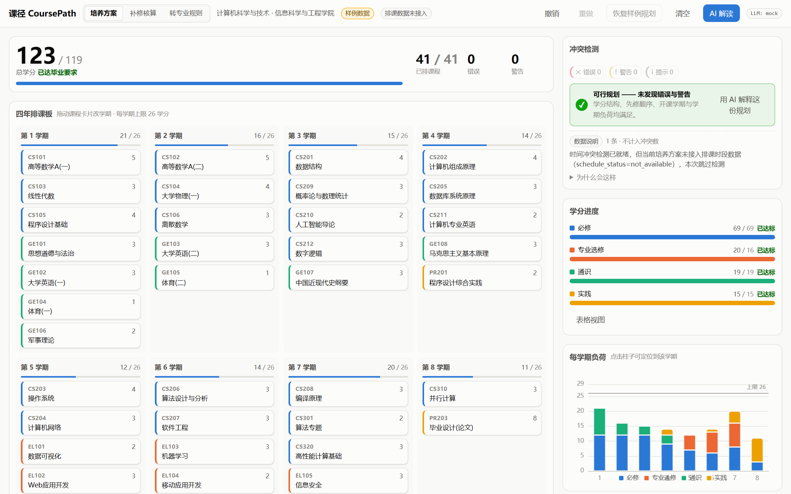
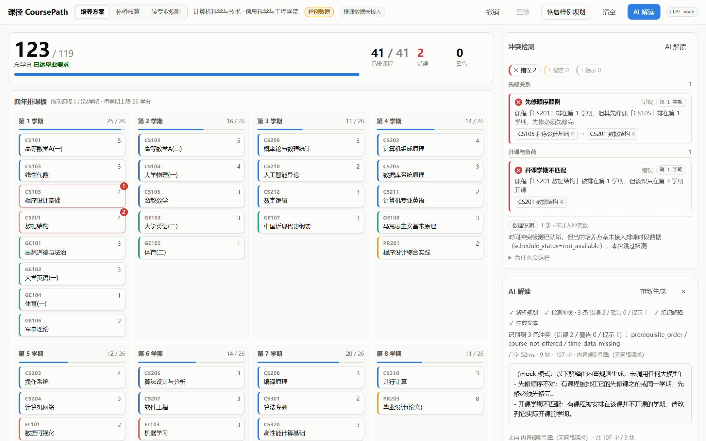
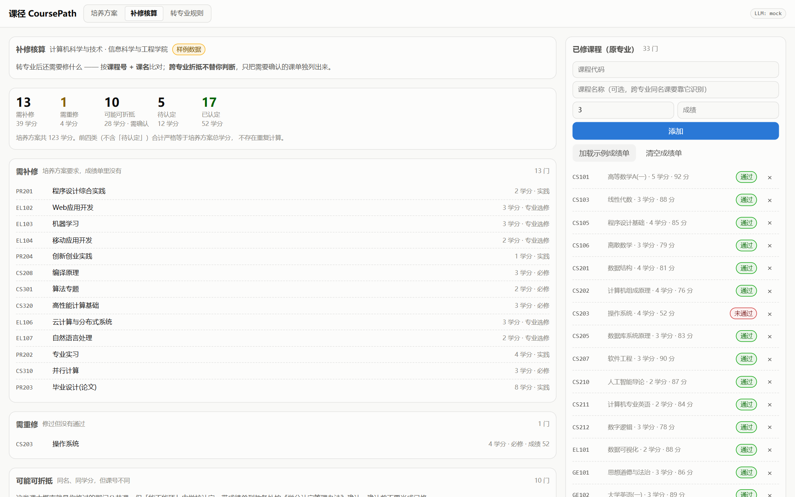
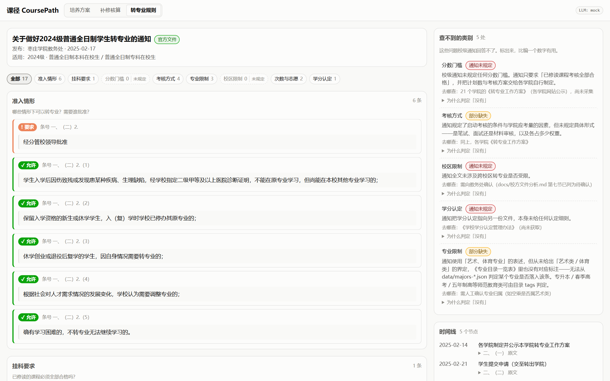
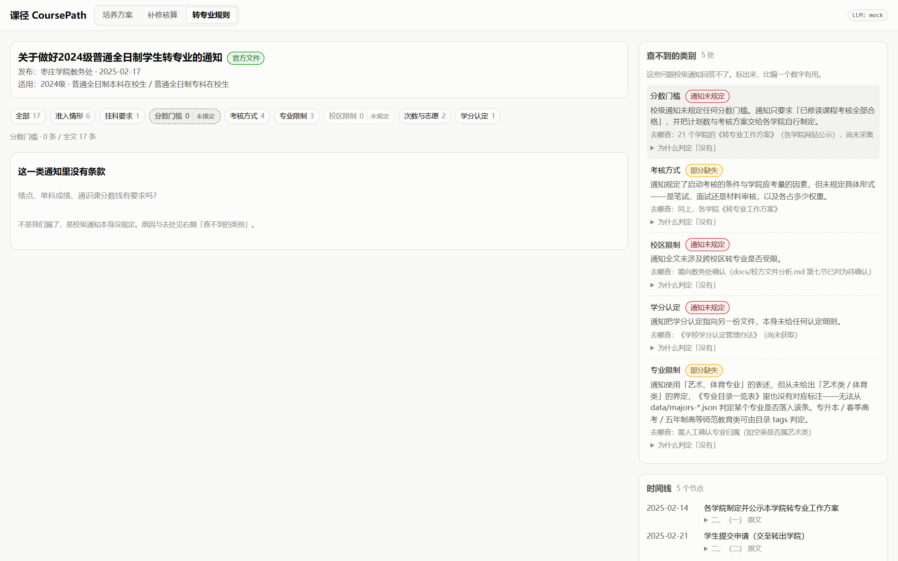
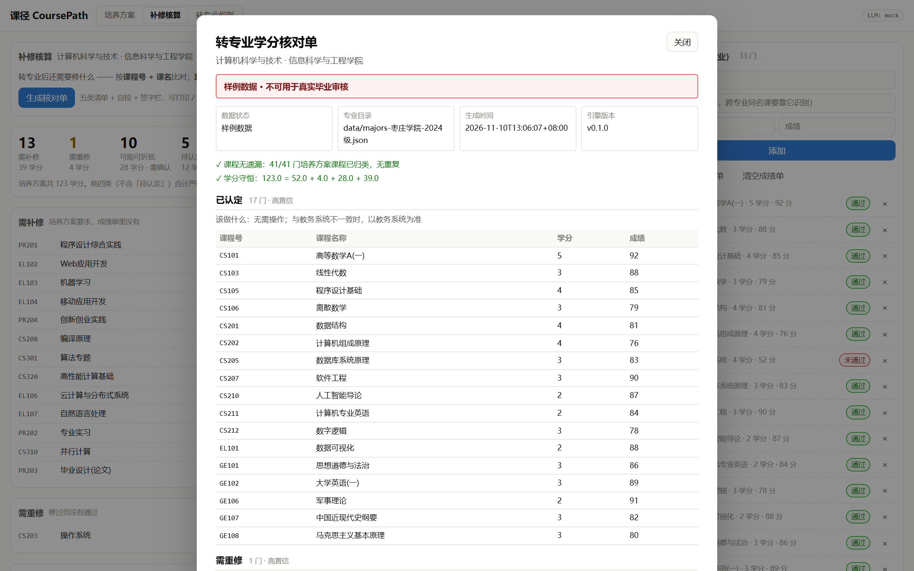

# 课径 CoursePath · 作品介绍

> 第九届传智杯 · 全国高校 Vibe Coding 开发挑战赛 · B 组（个人赛）
>
> 源码仓库：<https://github.com/hajimiaaa/chuanzhi>
> 技术文档：`docs/技术文档.pdf`（18 页）

---

## 一、项目详情与使用方式

### 1.1 一句话

把大学四年的培养方案，从一张看不懂的 PDF，变成**可拖拽调整、实时算学分、自动查冲突**的交互式路径图；
把转专业的官方规则，从散落的通知与表格，变成**能查、能比、并且敢说"查不到"**的结构化数据。

### 1.2 解决什么问题

调研了三类相互独立的信源（校园社区公开帖、公开报道、学校官方文件），指向同一个结论：
**挡住学生的不是能力，是信息到不了手。**

规则客观存在且公开，但取用成本高到让人放弃，于是学生只能靠学长学姐的口语经验拼图，
而拼出来的答案是互相矛盾的。最典型的一幕：同一个问题（某专业能否转出）在一条帖子下
得到了三个互相矛盾的答案——"好像不能转" / "艺术类只能在艺术类里转" / "你看看官网，官网有详细介绍"。

学校的官方文件本身也印证了这一点：转专业的**具体门槛分散在 21 个学院各自网站公示的方案里**，
校级通知只给框架。学生要拼出完整答案，得跨 4~5 份文件、21 个网站。

### 1.3 双入口，一套引擎

| 入口 | 用在什么时候 | 提供什么 |
|---|---|---|
| **认知入口** | 转专业**之前** | 规则查询：挂科要求、考核方式、专业限制、次数与志愿、时间线，以及**查不到的类别该去哪里查** |
| **核算入口** | 转专业**之后** | 培养方案可视化、冲突检测、**补修 / 重修清单** |

两个入口共用同一套核心引擎，因为两类输入是同一种东西：**官方文件**。

### 1.4 怎么用（10 分钟复现）

**环境**：Python 3.11+、Node 18+。**不需要任何 API Key**——应用默认运行在 mock 模式，全部功能可离线演示。

```bash
# ① 数据自检（纯标准库，不装依赖也能跑，这条链不经过 web 栈）
py -3.11 tools/validate_programs_json.py
py -3.11 tools/validate_rules_json.py

# ② 后端
cd backend
pip install -r requirements.txt
py -3.11 -m uvicorn app.main:app --reload --port 8000

# ③ 前端（另开一个终端）
cd frontend
npm install
npm run dev            # → http://localhost:5173
```

打开后是三个视图，对应产品的三条主线：

1. **培养方案**：默认加载一份可行解。拖动任意课程卡到别的学期 → 冲突面板实时冒红 →
   点击冲突可联动高亮对应课程卡 → 右上角「AI 解读」逐字流式解释。
   刷新页面不会丢（本地保存）；右侧「数据覆盖度」面板写明哪些数据尚未接入。
2. **补修核算**：点「加载示例成绩单」→ 立刻得到 已认定 / 需重修 / **可能可折抵** / 需补修 /
   待认定 五类清单与建议修读顺序。也可以逐门录入自己的已修课程（课程名可选，
   填了才能识别跨专业的同名课）。点「生成核对单」还能得到一张**可打印、可签字**的
   A4 核对草案（含自检与"该找谁确认"）。
3. **转专业规则**：17 条条款按 8 类分组，每条带原文条号与逐字引用；
   点「分数门槛」会看到**这一类没有条款**，右侧同时高亮对应的"缺口"及其去向。

### 1.5 项目结构

```
backend/app/    config / models / store / constraints / planner / llm / sse / schemas / main
backend/tests/  150 项单测（约束引擎 / 数据 / 接口 / 流式 / 规则 / 补修）
frontend/src/   api / state / hooks / lib / components（69 项单测）
data/           结构化数据：专业目录、转专业规则、培养方案
tools/          留痕导出、官方文件转换、零依赖自检、技术文档 PDF 生成
docs/           调研证据、校方文件分析、技术文档、开发日志、Prompt 链路
```

---

## 二、项目亮点

**1. 官方文件 → 结构化数据，而且引用能被机器复核。**

每个 JSON 都配一个可复现的转换脚本，产物里带 `source` 溯源块（学校 / 原件路径 / 生成脚本），
从产物可以一路倒推回官方原件。规则数据更进一步：每条条款都带原文条号与**逐字引用**，
生成脚本在写盘前会把每条引用拿回原文比对，对不上就拒绝生成。

**1.2 米之外还有一层**：独立的自检脚本（零依赖、不装 FastAPI 也能跑）会再做一遍同样的校验。
生成方与校验方**刻意不共用这段逻辑**——共用会让同一处错误在两边同时成立，校验就成了自我确认。

**2.「查不到」也是一等公民。**

校级通知只回答了八类问题中的五类。分数门槛、考核的具体形式、校区限制都不在这份文件里。
我们没有按常识补一个"通识课 70 分"上去，而是把它们做成显式的 `gaps`：

```json
{ "category": "score_threshold",
  "status": "not_available",
  "detail": "校级通知未规定任何分数门槛……",
  "absent_keywords": ["门槛", "分数线", "绩点", "70"],
  "where_to_find": "21 个学院的《转专业工作方案》，尚未采集" }
```

`absent_keywords` 是**反向断言**：脚本会去原文里检索这些词，一旦出现就报错。
于是"我们没找到"不是一句托词，而是一句可以被机器证伪的话。

**3. 引擎层零第三方依赖，形成一条独立复现链。**

领域模型、约束引擎、规划器、数据层只 `import` 标准库。因此数据校验脚本在**不装 FastAPI、
不开 venv** 的情况下就能跑通。如果领域模型依赖 Pydantic，这条链就断了——复现门槛会从
"有 Python"上升到"装完 web 栈"。

**4. 流式是可证伪的，不靠嘴说。**

mock 模式下的流式输出与非流式输出**逐字节相同**（有单测锁住这条等式），
`MockProvider._chunks()` 是唯一的真相来源：`complete()` 是它的拼接，`stream()` 是它加节奏。
一条 `curl -N` 就能看到 `meta → thinking → delta…` 逐条到达。

**5. 边界清晰。**

课径处理**信息问题**，不处理**学业能力问题**：转专业笔试考的是高中物理与高数，
绩点门槛是硬指标，这些我们不承诺覆盖。跨专业学分折抵需要学校的《学分认定管理办法》，
没有这份文件就不做。

---

## 三、AI 测试技术落地使用情况

本项目的测试不是"写完补几张单测"，而是把**验证本身**当作设计的一部分。

### 3.1 三层测试

| 层 | 数量 | 特点 |
|---|---|---|
| 后端单测 | **159 项** | 约束引擎、数据层、13 个接口、SSE 帧、规则引用回溯、补修分类 |
| 前端单测 | **82 项** | reducer 原子性与撤销重做、SSE 半帧跨块解帧、拖拽本地预判、规则登记表、成绩单 |
| 数据自检 | **2 个零依赖脚本** | 不装 web 栈即可运行，构成独立的复现链 |

### 3.2 AI 在测试中的三种用法

**① 让 AI 写"能证伪自己"的校验，而不是"能证明自己对"的断言。**

需求是"每条官方引用必须能在原文里找到"。AI 把它实现成生成脚本的前置断言：
逐字比对，对不上就拒绝生成。**这个校验第一次运行就红**——抓出我们自己转写时把原文的
「已修课程学习情况」写成了「已修读课程学习情况」，多了一个「读」字。
值得注意的是：人工整理的分析文档里同一句也是这么摘的，**两处人工摘录犯了同一个错**，
所以拿产物去对照分析文档是发现不了的，只有回原文才抓得住。

**② 确定性测试：打乱输入，输出必须逐字段相等。**

冲突列表、规划结果、补修分类都有这类测试。它挡的是"靠字典顺序碰巧正确"的隐性依赖。

**③ 换验证手段，而不是更仔细地看代码。**

有三类 Bug 的共同特征是：**程序不报错、页面不异常，功能却缺了一块**。
静态截图验证不了"某个东西**没有**出现"。于是用 `playwright-core` 驱动系统已装的 Edge，
真的去拖拽、去点击，并收集控制台输出与**计算后的样式**。三条具体战果：

| 缺陷 | 为什么截图看不出来 | 怎么发现的 |
|---|---|---|
| 图表上限线落在坐标区外被静默裁掉 | 页面一切正常，只是那条线不见了 | 驱动浏览器后核对实际渲染 |
| ECharts 未注册 `LineChart`，系列被静默丢弃 | 同上，且与上一条叠加，看了两轮都以为画好了 | 浏览器控制台错误 |
| 顶栏 tab 选中态被 `:hover` 覆盖 | 两种灰很接近，肉眼分辨不出 | 读 `getComputedStyle` 的实际背景色 |

**④ 用测试暴露"预埋"的数据丢失。**
录入成绩单之后才测试"清空排课"，发现它会连成绩单一起清掉——以前成绩单永远是空的，
所以这个 Bug 一直潜伏。修完补了回归测试。

### 3.3 结论

AI 在这里不只是"帮我写测试代码"，而是被要求**提出并执行能证伪的验证方案**。
这恰好也是本项目对"AI 协同"的理解：让 AI 给出可执行的验收，而不是一句"已完成"。

---

## 四、关键技术

| 层 | 技术 | 说明 |
|---|---|---|
| 后端 | FastAPI + 同步路由 | 路由全部 `def`：LLM 走 `urllib` 是阻塞调用，FastAPI 会丢进线程池；写成 `async def` 反而阻塞事件循环 |
| 领域层 | 纯标准库 dataclass | 无 I/O、无 web 依赖；两条禁令：不为领域模型定义 Pydantic 镜像、`models.py` 不出现文件读写 |
| 约束引擎 | 纯函数 `(plan, program) -> list[Conflict]` | 16 种冲突、6 个检查函数；**一条缺陷只由一个检查负责**；显式 `KIND_ORDER` + 排序保证确定性 |
| 图算法 | Kahn 拓扑排序 | 先修链排课；成环用**显式栈 DFS** 检测（递归会爆栈） |
| 存储 | JSON 文件 | 便于评审直接查看；**刻意不做缓存**（`lru_cache` + `--reload` 会造成"改了数据、接口纹丝不动"） |
| 流式 | SSE | `Provider.stream` 逐块产出；mock 与真实模型共用同一接口 |
| 前端 | React 19 + Vite + TypeScript | `@dnd-kit` 拖拽（原生 HTML5 DnD 触屏不支持、预览样式不可控）、ECharts 按需引入 + 懒加载 |
| 状态 | useReducer + Context | 变更原子化（拖拽是"移除+插入"，两个 `setState` 会有一帧课程消失）；撤销/重做天然属于 reducer |
| 样式 | 全局 CSS + BEM + 设计令牌 | 深浅色两套令牌；状态色永不复用为分类色，且始终 icon + 文字 + 颜色三者并存 |
| 文档 | pandoc + 无头 Edge | 技术文档与本文档均可一键由 Markdown 重生成 PDF |

**架构铁律**：`config / models / store / constraints / planner / llm / sse` 只允许 import 标准库；
Pydantic 只出现在 `schemas.py` 与 `main.py`。这条铁律换来的正是第三节说的独立复现链。

---

## 五、项目图片

**图 1 · 培养方案主视图**：四年八学期的泳道板，课程卡可拖拽；右侧实时冲突、学分进度与每学期负荷。
初始态是后端算出的可行解，所以"打开就是干净的"。



**图 2 · 拖错一门 → 实时冒红 → AI 逐字解释**：把「数据结构」拖到第 1 学期，立刻出现
先修顺序颠倒与开课学期不匹配两条错误；AI 解读面板展示了解析规划 → 检测冲突 → 组织解释 →
生成文本四个阶段，首字 50ms、9 块、107 字（mock 模式，无网络请求）。



**图 3 · 补修核算**：加载示例成绩单（33 门，软件工程 → 计算机科学与技术）后，得到
**需补修 13 / 需重修 1 / 可能可折抵 10 / 待认定 5 / 已认定 17** 五类清单。
五类刻意分开——它们对应五种不同的动作（去选课、去重修、**去教务处确认**、去问、不用管），
合并成"还差 N 门"会把这五件事混为一谈。前四类（不含待认定）学分之和严格等于培养方案总学分 123。



**图 4 · 转专业规则**：17 条条款按 8 类分组，每条带原文条号与逐字引用；
右侧是时间线、溯源块，以及**「查不到的类别」**。



**图 5 · 查不到，也是一种答案**：筛选「分数门槛」后主区显示"这一类通知里没有条款"，
右侧对应的缺口被高亮，并写明"为什么判定没有"（原文中从未出现"门槛/分数线/绩点/70"）
以及"该去哪里查"。



**图 6 · 可打印核对单**：五类清单 + 两项自检（41 门课全部归类、学分严格守恒）+
数据来源/状态/生成时间/引擎版本 + 三栏签字。样例数据下打印按钮置灰，
页首红条写明"不可用于真实毕业审核"——不让编造的数据生成一张看起来能签字的单子。



---

## 六、项目之前是否发表过或获奖

**没有。** 本项目是为本届赛事从零开发的原创作品，此前未在任何平台发表，也未参加其他赛事或获奖。
项目依赖的均为通用开源框架（React、Vite、FastAPI、@dnd-kit、ECharts），
业务代码、数据管道与文档均为本项目原创。

---

## 七、是否在其他项目基础上优化

**不是。** 本项目为独立原创，没有基于任何已有项目二次开发。

需要说明的是数据来源：项目使用的**官方文件**（《关于做好 2024 级普通全日制学生转专业的通知》
及其附件、专业目录一览表）来自枣庄学院教务处公开发布的文件，属于产品输入而非代码基础；
原始文件存于 `docs/调研原始材料/校方文件/`，转换脚本与溯源信息见 `tools/`。

> 边界说明：`data/programs/` 下的培养方案是**明确标注的样例数据**（`data_status: "sample"`），
> 专业名/学院/校区取自真实官方目录，课程与学分为演示需要编写，不是枣庄学院官方培养方案。
> 我们选择显式标注，而不是让样例与真实数据混在一起。

---

## 八、对预提交评审意见的回应

预提交评审提出：**"若因产品原因、功能不完善导致学生未能取得学分，该怎么办？"**
这不是一句免责声明能回答的问题。我们的处理是把"不完善"做成**显式功能**，
完整回复见 `docs/评审意见回复.md`。

| 层 | 修改 |
|---|---|
| **计算** | 修掉"跨专业同名课被误判为需补修"——新增 **「可能可折抵」** 第五类；前四类学分之和有单测保证恒等于培养方案总学分（不重不漏） |
| **数据** | 示例成绩单从 4 门换为 33 门：需补修从 38 门降到 13 门，另有 10 门"可能可折抵"、5 门"待认定"、17 门"已认定"；界面上新增**数据覆盖度面板**，直接写明培养方案 1/108、学院方案 0/21、排课时段与认定办法未接入 |
| **输出** | 五类分区，每类标注置信度与该做什么；「可能可折抵」不并进「已认定」，明确"确认前不要当成已修" |
| **责任** | **可打印核对单已实现**：五类清单 + 两项自检（课程无遗漏 / 学分守恒）+ 三栏签字；样例数据下打印置灰，避免"看起来能签字" |

**一句话**：我们没法保证"算得全对"——数据、认定办法、排课时段都还不完整；
但我们把**确定的、需要确认的、没有数据的**分成三类如实标出来，
并且保证已经算出来的部分**不重不漏**。学生拿到的不是"还差 13 门"，
而是一张写着"哪几条可以直接信、哪几条要去找谁确认"的清单。
